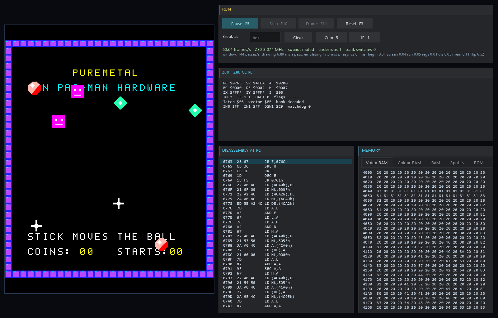

# Ms. Pac-Man for the Raspberry Pi Pico series — PureMetal

An emulator of the Ms. Pac-Man arcade machine (Midway / General Computer, 1981) for the Raspberry Pi
Pico W (RP2040) and Pico 2 W (RP2350), written in PureMetal and compiled with PureMetal Forge to
bare-metal machine code: no SDK, no RTOS. It runs the original program at the arcade board's own speed -
60.6 frames a second, every frame shown on an ST7796 panel - with the Namco sound chip played to a
Bluetooth speaker. A Windows version of the same machine, with a debugger, is included.

**No game ROMs are included.** Ms. Pac-Man's ROMs are commercial. The firmware has none in it; you load
your own set onto the board's flash (see [Loading the ROMs](#loading-the-roms)).



*The screenshot is the PureMetal demo program written for Pac-Man hardware ([demo/](demo/)), running in
the desktop version with its debug panes - its own graphics, not the game's.*

## Features

- The whole Ms. Pac-Man board: Z80 at 3.072 MHz (50,688 T-states a frame, 60.606 Hz), the memory map
  with its mirrors, the auxiliary board's decryption and its decode latch, the IM 2 interrupt, the
  watchdog, the dip switches, coin and start inputs.
- Video: the tile layer and eight sprites, drawn upright (the cabinet's monitor is turned) as 224 × 288,
  unscaled and centred on the 320 × 480 panel, sent strip by strip by DMA while the next strip is drawn.
- Sound: the Namco WSG, three voices at 96 kHz, mixed to 48 kHz and streamed to a Bluetooth A2DP speaker.
- Both cores: core 0 runs the Z80, the machine and the sound chip; core 1 draws and sends the picture and
  runs the Bluetooth stream.
- Thumb-2 on the Pico 2: the picture renderer, the sound chip and the Z80 core's dispatch are Cortex-M33
  inline assembly; the Pico W runs the same code compiled for its M0+.
- Plain Pac-Man hardware mode: programs written for Pac-Man boards (such as the PureMetal demo) run
  from a "plain" pack.
- Frame checking: `tools/grab.py` takes a frame from the board and compares every pixel with an
  independent drawing of the same video state.

## Supported hardware

| | Raspberry Pi Pico W | Raspberry Pi Pico 2 W |
|---|---|---|
| Chip, clock | RP2040, 200 MHz | RP2350 (Cortex-M33), 150 MHz |
| Display | LAFVIN ST7796 kit, 320 × 480 | the same |
| Controls | the kit's joystick and two buttons | the same |
| Sound | Bluetooth A2DP speaker | the same |
| Status | tested on the board | tested on the board |

The LAFVIN kit's wiring: LCD SCK/MOSI GP2/GP3 (SPI0), CS/DC/RST GP5/GP6/GP7, joystick GP26/GP27, buttons
GP15 (A) and GP14 (B).

## Performance (measured on the boards)

A played game (coin and start at 14 and 16 s), the silent build, compiler 2026-10-25. Milliseconds of
each core per second:

| Board | Frames a second | Core 0: Z80 / sound chip / idle | Core 1: drawing / panel wait / idle |
|---|---|---|---|
| Pico W, 200 MHz | 60.6, all shown, 0 dropped | 122 / 45 / 822 | 273 / 420 / 118 |
| Pico 2 W, 150 MHz, before Thumb-2 | 60.6, all shown, 0 dropped | 116-119 / 30-53 / 820-841 | 257-269 / 653-666 / 25 |
| Pico 2 W, 150 MHz, Thumb-2 | 60.6, all shown, 0 dropped | 106 / 14-20 / 860-867 | **91** / 827 / 26 |

On the Pico 2 W, Thumb-2 draws the picture about 2.9 times faster, runs the sound chip about 2.5 times
faster and the Z80 about 10 % faster. Core 1's spare time stays the same: it waits on the panel link
(SPI at 75 MHz on the Pico 2 W), and the time saved moves into that wait. With the Bluetooth speaker
connected, 125 audio packets a second went out with no underruns over about 40 s of play on both boards.

## Quick start

1. Download the firmware for your board from
   [Releases](https://github.com/ajtaji/MsPacmanEmulatorPicoSeries/releases/latest):
   `mspacman-pico-w.uf2` (Pico W) or `mspacman-pico2-w.uf2` (Pico 2 W).
2. Hold BOOTSEL while plugging the board in; it appears as a USB drive. Drag the `.uf2` onto it.
3. Load your ROM set once (next section). The ROMs stay in flash across firmware updates.
4. Insert a coin with **B**, start with **A**.

The released firmware is silent: Bluetooth needs your speaker's address built in
(see [Sound](#sound-bluetooth-speaker)).

## Loading the ROMs

You need the ROM set of the Ms. Pac-Man arcade board - for example from a board you own, or from a
licensed release of the game. The program uses MAME's `mspacman` set; the files are found by their
CRC-32, so any names work, in a folder or a zip:

| Files | What they are |
|---|---|
| `pacman.6e`, `pacman.6f`, `pacman.6h`, `pacman.6j` | the Pac-Man program ROMs the board is built on |
| `u5`, `u6`, `u7` | the auxiliary board's encrypted ROMs |
| `5e`, `5f` | tiles and sprites |
| `82s123.7f`, `82s126.4a`, `82s126.1m` | colour PROM, colour lookup PROM, sound waveform PROM |

Pack them (the original files, each checked by CRC-32 - the board does the decryption), then write the
pack to the board's flash at offset $40000 with PureMetal Forge (in PowerShell, quote `'$40000'`):

```
py -3 tools/pack_roms.py <folder-or-zip> -o mspacman.pack
PureMetalForge.exe --storage-write mspacman.pack --offset '$40000' --port COM7 -t rp2040     (Pico W)
PureMetalForge.exe --storage-write mspacman.pack --offset '$40000' --port COM6 -t rp2350     (Pico 2 W)
```

The upload reads the flash back and says VERIFIED. The firmware checks each file's CRC-32 on start-up and prints what it found over USB serial; a missing or
wrong file is named. It also prints the CRC-32 of the address space it decrypted, which must equal the
numbers `pack_roms.py` prints from its own decryption. Keep the pack out of any repository you publish.

Writing other programs to the same flash range (for example the NES emulator's store at $50000 is clear
of it, but a large firmware is not) overwrites the pack: load it again.

## Sound (Bluetooth speaker)

The speaker's address is built into the firmware. Copy `rp2040/mspacman.picow` (Pico W) or
`rp2350/mspacman.pico2w` (Pico 2 W) to a folder outside the repository, put the address in its
`Speaker` data (as a phone shows it: `AA:BB:CC:DD:EE:FF` becomes `Data.a $AA,$BB,$CC,$DD,$EE,$FF`),
change its `XIncludeFile` to the absolute path of the repository's `main.pico`/`main.pico2`, and build
the copy (below, `--source`). Put the speaker in pairing mode for the first start; after that the board
reconnects by its saved key in about 1.5 s.

## Controls

| Board | Arcade |
|---|---|
| Joystick | the 4-way joystick |
| B | coin |
| A | 1 player start |
| A + B | 2 player start |

Over USB serial (115200, any terminal): `w a s d` move, `5` coin, `1` / `2` start, `t` the service
switch, `0` release; `p` sends a frame for `tools/grab.py`, `i` the inputs, `z` the Z80's registers.
The firmware prints a line a second: frames, each core's busy time, the Bluetooth stream.

## Building from source

Requirements: PureMetal Forge (the PureMetal compiler) - this repository was built and tested with the
release of 2026-10-25 - and Python 3. The Z80 core lives in its own repository and is included from beside
this one:

```
git clone https://github.com/ajtaji/Z80EmulatorPicoSeries
git clone https://github.com/ajtaji/MsPacmanEmulatorPicoSeries
cd MsPacmanEmulatorPicoSeries
```

Pico W (`rp2040/` is the source):

```
py -3 tools/build.py --compiler <PureMetal Forge folder>\PureMetalForge.exe --output build\mspacman-pico-w.uf2
```

Pico 2 W (`rp2350/` is generated from `rp2040/` - never edit it by hand):

```
py -3 tools/port_rp2350.py
py -3 tools/build.py --compiler <...>\PureMetalForge.exe --source rp2350/mspacman.pico2w --output build\mspacman-pico2-w.uf2
```

Add `--port COM7 --seconds 30` to send the image to a connected board and record its serial output for
30 s. `build.py` refuses an image that would reach the ROM pack at $40000.

## The desktop version (Windows)

The same machine as a Windows program in PureBasic, drawn with the Neon Arcade Display Engine: the
screen scaled in the window, the sound on the PC's speakers, the keyboard, and debug panes - registers
and flags, the disassembly at PC, memory views, run / step / frame / breakpoint.

It needs PureBasic 6.41 for Windows (x64, the C back end) and two more repositories cloned beside this
one: the Z80 core and the [Neon Arcade Display Engine](https://github.com/ajtaji/Neon-Arcade-Dispay-Engine)
(the name is spelled "Dispay"). In PowerShell:

```
git clone https://github.com/ajtaji/MsPacmanEmulatorPicoSeries.git
git clone https://github.com/ajtaji/Z80EmulatorPicoSeries.git
git clone https://github.com/ajtaji/Neon-Arcade-Dispay-Engine.git
cd MsPacmanEmulatorPicoSeries
& "C:\Program Files\PureBasic\Compilers\pbcompilerc.exe" desktop\MsPacman.pb /EXE MsPacman.exe /THREAD /DPIAWARE
.\MsPacman.exe <ROM folder>
```

The engine and the Z80 core are found beside this repository; elsewhere, say where with
`/CONSTANT GL_ENGINE_DIR$=<folder>/` and `/CONSTANT MSP_Z80_DIR$=<Z80 repository>/desktop/` (trailing slash).
Keys: arrows, `5` or `C` coin, `1` / `2` start, F5 run/pause, F10 step, F11 frame, F3 reset, M mute.
Other modes: `--log N` (no window, a line a second; build with `/CONSOLE`), `--wav <file>` (the sound
chip's output), `--press 600:coin,660:start` (scripted inputs), `--shot <png> <frames>` (a screenshot),
`--dump <file>` (a frame for `tools/grab.py --file`).
`--pointer-test <log>` checks every control with synthetic pointer positions (four points on each, a press on
each button, a wheel turn on the memory pane) without touching the real pointer; its exit code is the number
of failures.

## The PureMetal demo for Pac-Man hardware

[demo/](demo/) is a program written in PureMetal for the compiler's Pac-Man board: a title, seven
bouncing sprites, a ball moved by the stick, coin and start counters and a tune on the sound chip. Its
built ROM set is in `demo/demo_roms/` - everything in it, graphics and PROMs included, is made from this
repository (`demo.pacman`, `make_assets.py`), so it can be shared freely.

```
build\MsPacman.exe demo\demo_roms                         (desktop)
py -3 tools/pack_roms.py --plain demo\demo_roms -o demo.pack   (then --storage-write it as above, at $40000)
```

## Testing

What has been checked on the boards (Pico W and Pico 2 W with the LAFVIN kit):

- Attract mode and a played game at 60.6 frames/s, 61 interrupts a second, no dropped frame, no watchdog
  reset, for 30-60 s runs.
- Frames taken over USB equal an independent drawing of the same video state in all 64,512 pixels
  (`tools/grab.py`, which shares no code or tables with the firmware), on both boards, BASIC and
  Thumb-2 renderers.
- The decryption: the board's CRC-32s of the decoded address space equal `pack_roms.py`'s
  (0000-3FFF 9F32CAE4, 8000-BFFF 6B637923).
- The Thumb-2 sound chip against the plain version on the board: 300 random trials, every sample equal
  (`rp2040/Diagnostics/wsg_check.pico2w`).
- Bluetooth sound in a played game: the coin chirp, the intro tune and play sound, 125 packets/s, 0
  underruns, on both boards.
- The desktop version: the same start-up as the board, frames equal to the reference, 60.2-61 frames/s.

## Known limits

- The joystick's orientation for the portrait picture (`#MSP_STICK_TURN`) has not been checked by hand.
- Not modelled: the cocktail cabinet's screen flip, coin lockout and the lamps.
- A frame sent over USB for checking now and then arrives one 64-byte packet short; `grab.py` reports
  it by length and a later frame is whole.
- On the Pico 2 W, core 1 has little spare time with Bluetooth on (the panel link is the limit).

## Repository layout

```
rp2040/          the Pico W source: machine, video, sound, Bluetooth, inputs, ROM store, main
rp2350/          the Pico 2 W source, generated by tools/port_rp2350.py
desktop/         the Windows version
demo/            the PureMetal demo for Pac-Man hardware and its built ROMs
tools/           build.py, pack_roms.py, port_rp2350.py, grab.py
licenses/        third-party licences and credits
```

## Licence

MIT (see [LICENSE](LICENSE)), copyright 2026 ajtaji.

Firmware built with Bluetooth audio contains the CYW43439 Bluetooth firmware data, under its own
licences (`licenses/CYW43439-*.txt`); the SBC encoder's coefficients are cross-checked against BlueZ
(`licenses/SBC-TABLES.md`, LGPL-2.1). The hardware's behaviour was taken from MAME's drivers
(BSD-3-Clause; what was taken is listed in `licenses/MAME.md`). Ms. Pac-Man and Pac-Man are trademarks
of their owners; this project is not affiliated with them and includes none of their ROMs or artwork.
